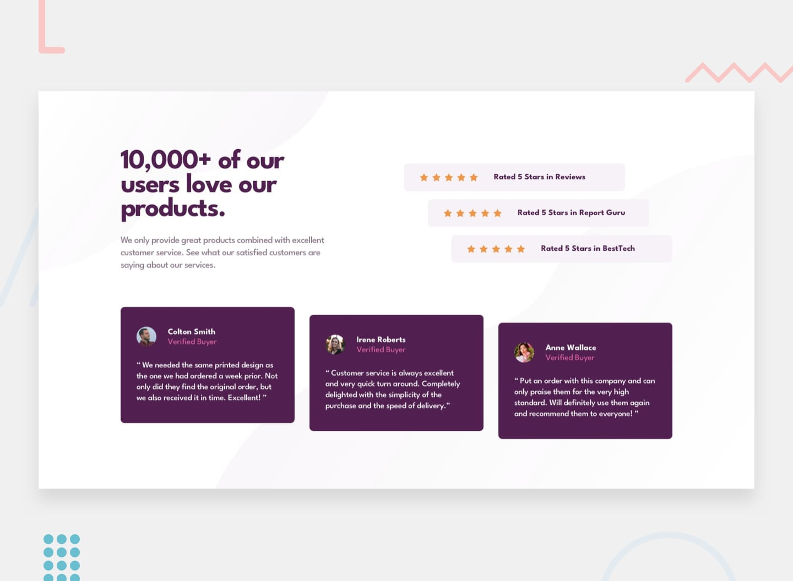

# Frontend Mentor - Social proof section



A responsive **Social Proof Section** built with HTML and Tailwind CSS as a [Frontend Mentor](https://www.frontendmentor.io/) challenge.

The project showcases customer ratings and testimonials in a clean, organized layout while practicing responsive design and Tailwind CSS utilities.

## Preview


## Built With

- HTML5
- Tailwind CSS
- Google Fonts — League Spartan

## Features

- Customer ratings and reviews
- Testimonial cards with customer information
- Responsive layout for different screen sizes
- Custom colors, typography, and spacing
- Tailwind CSS utility classes for styling

## What I Learned

While building this project, I practiced:

- Structuring a page with HTML
- Using Tailwind CSS for layout and styling
- Working with Flexbox and CSS Grid
- Applying responsive breakpoints
- Managing spacing, typography, and colors
- Comparing my implementation with a design reference and identifying areas for improvement

## Getting Started

1. Clone this repository:

   ```bash
   git clone https://github.com/Sumeya472/social-proof-section.git
   ```

2. Open the project folder.

3. Open `index.html` in your browser.

The project uses the Tailwind CSS browser CDN, so an internet connection is needed to load Tailwind styles.

## Acknowledgments

- [Frontend Mentor](https://www.frontendmentor.io/) for the design challenge.
- [Google Fonts](https://fonts.google.com/) for the League Spartan typeface.

---

Built as part of my journey to improve my frontend development skills.
